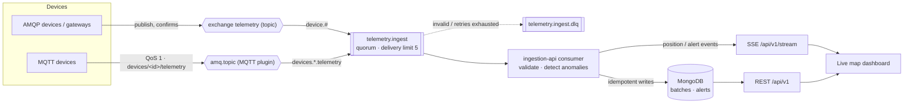

# Wayline

[](https://github.com/amirhoseinhoseinpoor/iot-signal-pipeline/actions/workflows/ci.yml)


**Real-time GPS telemetry for vehicle fleets.**

Wayline ingests position and speed readings from tracking devices over AMQP or
MQTT, stores them with per-trip statistics, detects speeding and impossible
position jumps, and streams everything live to a map dashboard. It is built to
keep working when parts of the system fail: the broker restarts, the database is
briefly unavailable, or a device sends the same batch twice.



## Features

**Ingestion**

- **AMQP and MQTT.** Both transports feed one queue with the same guarantees. MQTT goes through RabbitMQ's plugin, so no extra broker or bridge is needed.
- **No data loss on crash.** A message is acknowledged only after it is stored; otherwise the broker redelivers it.
- **Exactly-once storage on top of at-least-once delivery.** Every batch carries a `messageId`, backed by a unique index.
- **Poison messages are isolated.** Invalid batches go straight to a dead-letter queue, and transient failures are retried five times before they are dead-lettered.
- **Device and topic binding.** An MQTT message whose payload claims a different device than its topic is rejected.
- **Self-healing connections.** Both services reconnect to the broker automatically.

**Fleet intelligence**

- **Route statistics.** Distance (haversine), duration, and maximum and average speed for every batch.
- **Anomaly detection.** Overspeed episodes, reported once at their peak, and GPS jumps that imply impossible speeds, stored as queryable alerts.
- **Fleet overview.** Last position, speed, totals and an online or stale status for every device.

**Real time**

- **Live stream.** Server-Sent Events push `position` and `alert` events as batches are stored.
- **Map dashboard.** Live markers, trails, a device list and an alert feed, served at `/`.

**Engineering**

- TypeScript in strict mode, the same DTO validation for HTTP and AMQP, and environment validation at startup.
- Unit tests, end-to-end API tests against a real MongoDB, and a full `docker compose` smoke test in CI.
- Liveness and readiness probes, graceful shutdown, OpenAPI docs, and multi-stage non-root images.

## Quick start

Requirements: Docker with Compose v2.

```bash
docker compose up --build
```

| What                 | Where                                                           |
| -------------------- | --------------------------------------------------------------- |
| Live dashboard       | http://localhost:3000                                           |
| API docs (Swagger)   | http://localhost:3000/docs                                      |
| Readiness probe      | http://localhost:3000/health/ready                              |
| RabbitMQ management  | http://localhost:15672 (user `wayline`, password `wayline`)     |
| MQTT broker          | `mqtt://localhost:1883` (same credentials)                      |

The simulator drives five vehicles around Berlin. By default it uses `mixed` mode:
even-numbered vehicles publish over AMQP and odd-numbered ones over MQTT. About 5%
of batches carry an injected anomaly, so alerts show up on the dashboard. To change
the load:

```bash
DEVICE_COUNT=50 PUBLISH_INTERVAL_MS=1000 ANOMALY_RATE=0.2 docker compose up --build
```

To send a batch by hand over MQTT (with [mosquitto-clients](https://mosquitto.org/download/)):

```bash
mosquitto_pub -h localhost -u wayline -P wayline -q 1 -t devices/truck-7/telemetry \
  -m '{"messageId":"manual-1","deviceId":"truck-7","recordedAt":"2026-11-18T10:00:00Z","readings":[{"offsetMs":0,"lat":52.52,"lng":13.405,"speedMps":12}]}'
```

## Telemetry message

The same body is accepted on every path:

- AMQP: the `telemetry` exchange, with routing key `device.<deviceId>`
- MQTT: the topic `devices/<deviceId>/telemetry`
- HTTP: `POST /api/v1/telemetry`

```json
{
  "messageId": "3f1c9a4e-8d2b-4c55-9a51-0b7c2e6f1d90",
  "deviceId": "vehicle-001",
  "recordedAt": "2026-11-17T09:30:00.000Z",
  "readings": [
    { "offsetMs": 0,    "lat": 52.520008, "lng": 13.404954, "speedMps": 8.3 },
    { "offsetMs": 1000, "lat": 52.520081, "lng": 13.405012, "speedMps": 8.6 }
  ]
}
```

| Field        | Rules                                                                 |
| ------------ | --------------------------------------------------------------------- |
| `messageId`  | 1 to 128 characters, unique per batch; it is the idempotency key       |
| `deviceId`   | 1 to 64 characters: letters, digits, `.`, `_` or `-`; must match the MQTT topic |
| `recordedAt` | ISO 8601 timestamp of the first reading                               |
| `readings`   | 1 to 1000 items; `offsetMs` is relative to `recordedAt`               |
| `lat`/`lng`  | Valid WGS84 coordinates                                               |
| `speedMps`   | Ground speed in metres per second, 0 to 150                           |

## REST API

Endpoints are under `/api/v1` unless noted. Full schemas are in Swagger at `/docs`.

| Method | Path              | Description                                                                 |
| ------ | ----------------- | --------------------------------------------------------------------------- |
| POST   | `/telemetry`      | Ingest a batch. `201` when new, `200` when the `messageId` was seen before |
| GET    | `/telemetry`      | Paginated list, newest first. Filters: `deviceId`, `from`, `to`, `page`, `limit` |
| GET    | `/telemetry/:id`  | One batch including raw readings                                            |
| DELETE | `/telemetry/:id`  | Delete a batch                                                              |
| GET    | `/devices`        | Per-device totals, last position and speed, `online` or `stale` status      |
| GET    | `/alerts`         | Alerts, newest first. Filters: `deviceId`, `type`, `from`, `to`, `page`, `limit` |
| GET    | `/stream`         | Server-Sent Events: `position`, `alert`, `ping`. Optional `deviceId`        |
| GET    | `/health/live`    | Liveness (outside `/api/v1`)                                                |
| GET    | `/health/ready`   | Readiness: `503` unless MongoDB and RabbitMQ are both reachable             |

## Configuration

| Service          | Variable                     | Default              | Meaning                                       |
| ---------------- | ---------------------------- | -------------------- | --------------------------------------------- |
| ingestion-api    | `MONGO_URI`, `AMQP_URL`      | required             | Connections                                   |
|                  | `OVERSPEED_LIMIT_MPS`        | `33.3`               | Speed that raises an `overspeed` alert        |
|                  | `MAX_IMPLIED_SPEED_MPS`      | `70`                 | Implied speed that raises a `gps_jump` alert  |
|                  | `DEVICE_STALE_AFTER_SECONDS` | `60`                 | Silence after which a device is `stale`       |
|                  | `AMQP_PREFETCH`              | `20`                 | Unacknowledged messages per consumer          |
| device-simulator | `TRANSPORT`                  | `amqp` (compose: `mixed`) | `amqp`, `mqtt` or `mixed`                |
|                  | `DEVICE_COUNT`               | `5`                  | Simulated vehicles                            |
|                  | `PUBLISH_INTERVAL_MS`        | `5000`               | One batch per vehicle per interval            |
|                  | `ANOMALY_RATE`               | `0.05`               | Share of batches with an injected anomaly     |

## Repository layout

```
services/
  ingestion-api/       NestJS: AMQP consumer, REST API, SSE stream, dashboard
    src/telemetry/     domain logic (route stats, anomaly detection), schemas, services, controllers
    src/messaging/     broker topology, consumer, ack, retry and dead-letter decisions
    src/health/        liveness and readiness probes
    public/            live map dashboard (Leaflet + EventSource)
    test/              end-to-end tests against an in-memory MongoDB
  device-simulator/    NestJS worker: kinematic vehicle model, anomaly injection, AMQP and MQTT publishers
deploy/rabbitmq/       broker plugins (management, MQTT, Prometheus)
scripts/smoke-test.sh  end-to-end check of a running stack
docs/adr/              architecture decision records
```

## Development

Each service is a standalone Node.js project (Node 20 or later).

```bash
docker compose up mongo rabbitmq
cd services/ingestion-api
cp .env.example .env
npm install
npm run start:dev
```

| Command              | What it does                                         |
| -------------------- | ---------------------------------------------------- |
| `npm test`           | Unit tests                                           |
| `npm run test:e2e`   | API tests against a real, in-memory MongoDB          |
| `npm run test:cov`   | Unit tests with coverage                             |
| `npm run lint`       | ESLint with type-aware rules and Prettier            |
| `npm run typecheck`  | TypeScript in strict mode                            |

On every push and pull request, CI runs all of these for both services. It then
starts the full stack with Docker Compose and runs `scripts/smoke-test.sh`, which
checks that:

- devices report over both AMQP and MQTT
- alerts are raised
- the dead-letter queue stays empty

## Design decisions

1. [Quorum queue with a delivery limit and a dead-letter queue](docs/adr/0001-quorum-queue-and-dead-lettering.md)
2. [Idempotent ingestion keyed on `messageId`](docs/adr/0002-idempotent-ingestion.md)
3. [One telemetry document per batch](docs/adr/0003-batch-per-document.md)
4. [MQTT ingestion through RabbitMQ's MQTT plugin](docs/adr/0004-mqtt-through-rabbitmq-plugin.md)
5. [Server-Sent Events for live updates](docs/adr/0005-server-sent-events-for-live-updates.md)
6. [Anomaly detection at ingest time](docs/adr/0006-anomaly-detection-at-ingest.md)

## Roadmap

- [x] Reliable ingestion: dead-lettering, idempotency, reconnects, validation
- [x] Tests and CI
- [x] MQTT ingestion
- [x] Anomaly detection (overspeed, GPS jumps) and alerts
- [x] Live stream and map dashboard
- [ ] Cross-batch detection and stale-device alerts
- [ ] Metrics (Prometheus) and dashboards (Grafana)
- [ ] Per-device credentials and MQTT topic permissions

## License

[MIT](LICENSE)
